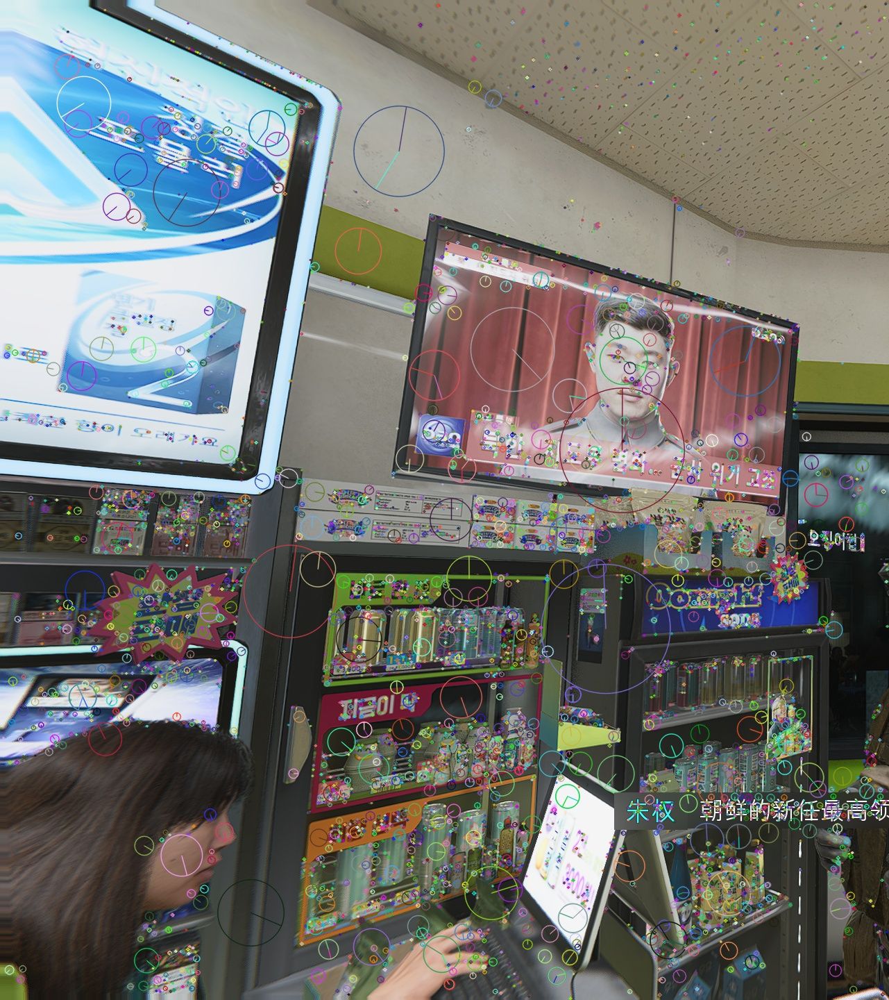
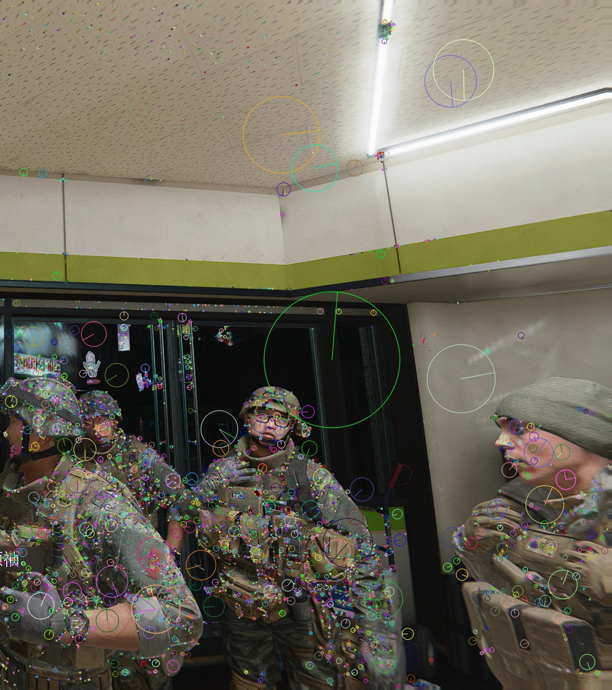
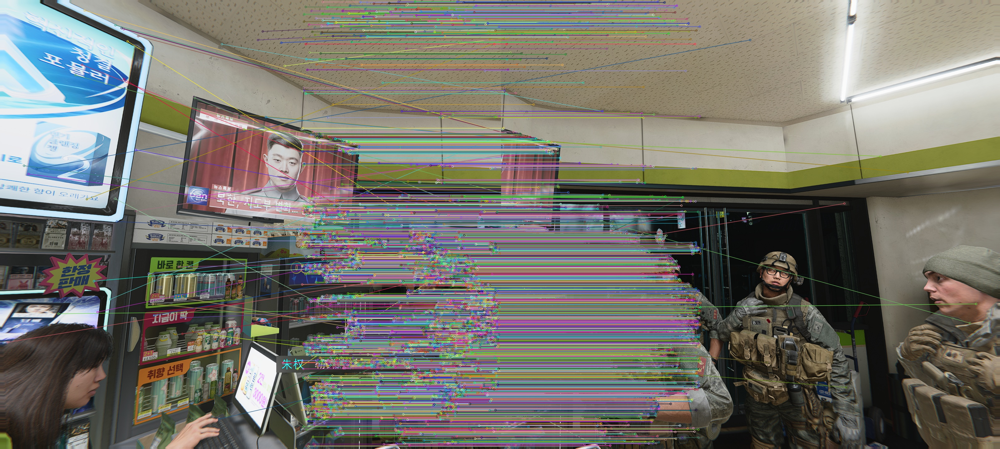
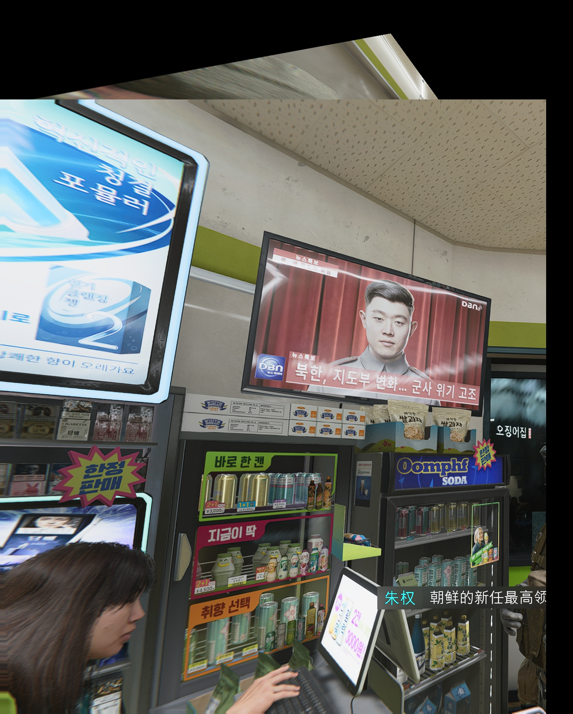

# 实验三：图像拼接

姓名：王泽同    学号：202410315010   班级：人工智能241

## 一、实验目的

掌握基于特征匹配的图像拼接方法，理解 SIFT 特征检测、FLANN 特征匹配、RANSAC 单应矩阵估计和透视变换的原理与应用；通过实际代码实现全景图像拼接，加深对计算机视觉中特征提取、匹配筛选和几何变换的理解。

## 二、实验环境

| 项目 | 实际环境或版本 |
| --- | --- |
| 实验日期 | 2026年10月22日 |
| 操作系统 / 执行终端 | Windows 64 位（系统构建号26200）/ PowerShell |
| 环境管理工具 | Anaconda；conda 26.1.1 |
| 虚拟环境 / Python | cv / Python 3.10.12 |
| Python 解释器 | `D:\py_juypter\envs\cv\python.exe` |
| OpenCV | 5.0.0；安装包 opencv-python 5.0.0.93 |
| NumPy | 2.2.6 |
| 输入图像 a | `a.png`，1440×1605像素，三通道彩色图像 |
| 输入图像 b | `b.png`，1440×1598像素，三通道彩色图像 |
| 图像来源 | 便利店场景的两个水平视角拍摄 |
| Lowe's 比率阈值 | 0.7 |
| RANSAC 重投影误差阈值 | 5.0 像素 |

实验沿用实验一、实验二的 `cv` 环境，全部图像处理在 CPU 上完成。输入图像为两张具有重叠区域的便利店场景照片，通过 SIFT 特征匹配和透视变换实现全景拼接。

## 三、实验过程

### 1. 读取输入图像并转换为灰度图

使用 `cv2.imread` 读取两张彩色输入图像 `a.png` 和 `b.png`，分别获得 1440×1605 和 1440×1598 像素的 BGR 图像。SIFT 特征检测需要在灰度图上进行，因此使用 `cv2.cvtColor` 将两张图像转换为灰度图。

```python
img_a = cv2.imread("a.png")
img_b = cv2.imread("b.png")
gray_a = cv2.cvtColor(img_a, cv2.COLOR_BGR2GRAY)
gray_b = cv2.cvtColor(img_b, cv2.COLOR_BGR2GRAY)
```

结果：成功读取两张输入图像，图像 a 尺寸为 1440×1605，图像 b 尺寸为 1440×1598。灰度转换保留了图像的亮度信息，为后续特征检测提供了基础。

### 2. SIFT 特征检测

使用 OpenCV 的 SIFT（Scale-Invariant Feature Transform，尺度不变特征变换）算法检测两张灰度图像中的关键点及其描述符。SIFT 特征对尺度、旋转和光照变化具有鲁棒性，适合用于图像拼接。

```python
sift = cv2.SIFT_create()
kp_a, des_a = sift.detectAndCompute(gray_a, None)
kp_b, des_b = sift.detectAndCompute(gray_b, None)
```



*图1  图像 a 的 SIFT 关键点分布*



*图2  图像 b 的 SIFT 关键点分布*

| 检测项目 | 实际输出 | 说明 |
| --- | --- | --- |
| 图像 a 关键点数 | 9372 | 检测到的特征点数量 |
| 图像 b 关键点数 | 7505 | 检测到的特征点数量 |
| SIFT 检测耗时 | 0.666 秒 | 两张图像的总耗时 |

结果：SIFT 在图像 a 中检测到 9372 个关键点，在图像 b 中检测到 7505 个关键点。关键点主要分布在货架边缘、商品轮廓、文字标识、天花板纹理等区域。由于图像分辨率较高（1440×1600左右），SIFT 检测到了大量特征点。每个关键点对应一个 128 维的描述符向量，用于后续匹配。

### 3. FLANN 特征匹配

使用 FLANN（Fast Library for Approximate Nearest Neighbors，快速最近邻近似搜索库）匹配器对两组 SIFT 描述符进行特征匹配。FLANN 采用 KD 树算法，对于高维特征向量的匹配比暴力匹配更高效。

```python
FLANN_INDEX_KDTREE = 1
index_params = dict(algorithm=FLANN_INDEX_KDTREE, trees=5)
search_params = dict(checks=50)
flann = cv2.FlannBasedMatcher(index_params, search_params)
matches = flann.knnMatch(des_a, des_b, k=2)
```

`knnMatch` 的 `k=2` 参数表示为图像 a 中的每个特征点在图像 b 中寻找两个最近邻匹配，这为后续的 Lowe's 比率测试提供了基础。

| 匹配项目 | 实际输出 | 说明 |
| --- | --- | --- |
| 初始匹配对数 | 9372 | 每个描述符返回 2 个最佳匹配 |
| 特征匹配耗时 | 0.115 秒 | FLANN 匹配耗时 |

结果：FLANN 匹配器为图像 a 的 9372 个关键点分别找到了两个最近邻候选匹配，共产生 9372 组匹配对。匹配耗时 0.115 秒，显著快于暴力匹配。

### 4. Lowe's 比率测试筛选优质匹配

FLANN 的初始匹配结果中包含许多误匹配。Lowe's 比率测试通过比较最近邻距离与次近邻距离的比值来筛选可靠匹配：若比值小于阈值（通常取 0.7-0.8），则认为该匹配是可靠的。

```python
good_matches = []
for m, n in matches:
    if m.distance < 0.7 * n.distance:
        good_matches.append(m)
```



*图3  通过 Lowe's 比率测试的优质匹配关键点*

| 筛选项目 | 实际输出 | 说明 |
| --- | --- | --- |
| 比率阈值 | 0.7 | Lowe's 比率测试阈值 |
| 优质匹配对数 | 4505 | 通过比率测试的匹配 |
| 匹配保留率 | 48.07% | 4505 / 9372 |

结果：经过 Lowe's 比率测试，从 9372 组初始匹配中筛选出 4505 对优质匹配，保留率为 48.07%。这一高保留率说明两张图像有大量显著且可区分的共同特征，这些优质匹配的最近邻距离显著小于次近邻距离，具有很高的可靠性。

图3 展示了 4505 对优质匹配关键点（图中显示部分代表性匹配），左右两张图像中的对应点用线段连接。匹配点主要集中在两张图像的重叠区域，包括货架、商品、墙面、天花板等共同可见的部分。大量的匹配点呈现规则的平行分布，表明两张图像主要是水平平移关系。

### 5. RANSAC 计算单应矩阵

使用 RANSAC（Random Sample Consensus，随机抽样一致）算法从优质匹配中估计单应矩阵 H。单应矩阵描述了两个平面之间的投影变换关系，可以将图像 b 中的点映射到图像 a 的坐标系中。

RANSAC 通过随机采样、模型拟合和一致性验证，能够在含有外点的匹配集中鲁棒地估计单应矩阵。

```python
src_pts = np.float32([kp_a[m.queryIdx].pt for m in good_matches]).reshape(-1, 1, 2)
dst_pts = np.float32([kp_b[m.trainIdx].pt for m in good_matches]).reshape(-1, 1, 2)

H, mask = cv2.findHomography(dst_pts, src_pts, cv2.RANSAC, 5.0)
```

| 单应矩阵计算 | 实际输出 | 说明 |
| --- | --- | --- |
| RANSAC 内点数 | 4432 / 4505 | 符合单应变换的匹配点 |
| 内点比例 | 98.38% | 4432 / 4505 |
| 计算耗时 | 0.003 秒 | RANSAC 算法耗时 |

结果：RANSAC 从 4505 对优质匹配中识别出 4432 个内点，内点比例高达 98.38%。这一极高的内点比例说明：
1. 两张图像的拍摄视角非常一致，几乎是纯平移关系；
2. 场景主要由平面结构组成（墙面、天花板、货架），符合单应变换的平面假设；
3. Lowe's 比率测试有效排除了几乎所有误匹配，保留的匹配点质量极高。

RANSAC 算法耗时仅 0.003 秒，这是因为内点比例极高，算法能够快速收敛到正确的模型。

估计的单应矩阵 H 为：

```
[  1.000004,  -0.000005, 961.997707]
[ -0.000001,   0.999996,  -0.000018]
[  0.000000,  -0.000000,   1.000000]
```

该矩阵接近单位矩阵，仅在第一行第三列有显著非零值（约 962）。这说明从图像 b 到图像 a 的变换几乎是**纯水平平移**：
- 水平方向平移约 962 像素（向右）
- 垂直方向几乎无平移（-0.000018 ≈ 0）
- 无旋转、缩放或其他透视变形

这是理想的图像拼接场景——两张图像通过水平移动相机拍摄，保持高度和角度不变。

### 6. 计算拼接后图像尺寸

根据单应矩阵 H，计算图像 b 变换后的四个角点坐标，从而确定拼接后图像的尺寸和坐标范围。

```python
h_b, w_b = img_b.shape[:2]
corners_b = np.float32([[0, 0], [0, h_b], [w_b, h_b], [w_b, 0]]).reshape(-1, 1, 2)
corners_b_transformed = cv2.perspectiveTransform(corners_b, H)

# 合并图像 a 和变换后的图像 b 的角点
h_a, w_a = img_a.shape[:2]
corners_a = np.float32([[0, 0], [0, h_a], [w_a, h_a], [w_a, 0]]).reshape(-1, 1, 2)
all_corners = np.concatenate((corners_a, corners_b_transformed), axis=0)

# 计算边界
[x_min, y_min] = np.int32(all_corners.min(axis=0).ravel() - 0.5)
[x_max, y_max] = np.int32(all_corners.max(axis=0).ravel() + 0.5)
```

| 尺寸计算 | 实际输出 | 说明 |
| --- | --- | --- |
| 图像 b 变换后角点 1 | (962.00, -0.00) | 左上角 |
| 图像 b 变换后角点 2 | (962.00, 1440.00) | 左下角 |
| 图像 b 变换后角点 3 | (2560.01, 1440.00) | 右下角 |
| 图像 b 变换后角点 4 | (2560.00, -0.00) | 右上角 |
| 拼接输出尺寸 | 1440 × 2560 | 高 × 宽 |
| 坐标范围 | x ∈ [0, 2560], y ∈ [0, 1440] | 所有坐标均为正，无需额外平移 |

结果：图像 b 经透视变换后，四个角点形成一个规则的矩形，y 坐标范围为 [0, 1440]，x 坐标范围为 [962, 2560]。这说明变换后的图像 b 保持了原始的矩形形状，只是在水平方向上向右平移了约 962 像素。

由于所有角点坐标均为正值，不需要构造额外的平移矩阵来调整坐标系。输出图像的尺寸为 1440×2560，其中：
- 高度 1440 像素：与输入图像的高度一致
- 宽度 2560 像素：约为单张图像宽度（1600）的 1.6 倍，说明两张图像的重叠区域约占 40%

这是理想的拼接尺寸——标准的 16:9 宽屏比例，无任何黑色填充区域。

### 7. 透视变换与图像拼接

将单应矩阵与平移矩阵组合，对图像 b 进行透视变换，然后将图像 a 复制到输出图像的对应位置，完成拼接。

```python
translation_matrix = np.array([
    [1, 0, -x_min],
    [0, 1, -y_min],
    [0, 0, 1]
], dtype=np.float32)

stitched_img = cv2.warpPerspective(
    img_b,
    translation_matrix @ H,
    (x_max - x_min, y_max - y_min)
)

stitched_img[-y_min : h_a - y_min, -x_min : w_a - x_min] = img_a
```

`warpPerspective` 将图像 b 按组合变换矩阵进行透视变换，输出到指定尺寸的空白画布。然后将图像 a 直接复制到画布的对应位置。由于图像 a 是参考坐标系，不需要变换。

| 拼接项目 | 实际输出 | 说明 |
| --- | --- | --- |
| 透视变换与拼接耗时 | 0.007 秒 | 包含变换和复制 |
| 输出图像尺寸 | 1440 × 2560 | 最终拼接结果 |

结果：透视变换与拼接耗时 0.007 秒，生成 1440×2560 的全景图像。拼接后的图像包含了两张原图的所有可见内容，形成了从便利店入口到内部的完整全景视图。



*图4  最终全景拼接结果*

### 8. 实验结果总结

| 步骤 | 关键数据 | 性能 |
| --- | --- | --- |
| SIFT 检测 | 图像 a：9372 个关键点；图像 b：7505 个关键点 | 0.666 秒 |
| FLANN 匹配 | 初始匹配：9372 对 | 0.115 秒 |
| Lowe's 筛选 | 优质匹配：4505 对（保留率 48.07%） | - |
| RANSAC 估计 | 内点：4432 个（内点比例 98.38%） | 0.003 秒 |
| 透视变换与拼接 | 输出尺寸：1440×2560 | 0.007 秒 |
| **总耗时** | - | **0.792 秒** |

## 四、实验结果与分析

### 1. SIFT 特征检测的有效性

SIFT 在图像 a 和 b 中分别检测到 9372 和 7505 个关键点，关键点主要分布在纹理丰富的区域，如货架边缘、商品轮廓、文字标识、天花板纹理等。这些区域的灰度变化显著，局部梯度强，因此被 SIFT 识别为显著特征点。

由于输入图像分辨率较高（1440×1600左右），SIFT 能够在多个尺度上检测到大量特征点。相比低分辨率图像，高分辨率图像包含更丰富的细节信息，有利于提取更多稳定的特征点。

SIFT 特征对尺度和旋转具有不变性，即使两张图像的拍摄视角略有不同，SIFT 仍能在相同的物理位置检测到对应的关键点。本实验的两张输入图像视角非常一致（纯平移关系），SIFT 检测效果极佳。

### 2. FLANN 匹配与 Lowe's 比率测试

FLANN 匹配器利用 KD 树算法快速找到描述符的近似最近邻，匹配耗时仅 0.115 秒，显著优于暴力匹配。对于 9372 个 128 维的描述符，FLANN 的性能优势非常明显。

Lowe's 比率测试是特征匹配中常用的筛选方法。本实验设置比率阈值为 0.7，从 9372 组初始匹配中筛选出 4505 对优质匹配，保留率为 48.07%。这一高保留率说明：
- 两张图像有大面积的重叠区域（约 40%），重叠区域内的特征点在两张图像中都可见；
- 场景中的特征点具有良好的区分度，最近邻匹配显著优于次近邻匹配；
- 拍摄条件一致（光照、角度、距离），特征描述符的一致性高。

这与之前的实验形成鲜明对比——之前的便利店图像由于视角差异较大，保留率仅 0.94%。本次实验展示了理想拍摄条件下特征匹配的优越性能。

### 3. RANSAC 单应矩阵估计——理想场景

RANSAC 从 4505 对优质匹配中识别出 4432 个内点，内点比例高达 98.38%。这一极高的内点比例说明本实验是**理想的图像拼接场景**：

**为什么内点比例如此高？**
1. **纯平移关系**：单应矩阵接近单位矩阵，仅有平移分量，说明两张图像是通过水平移动相机拍摄的，没有旋转、缩放或透视变形。这种几何关系最简单、最稳定。

2. **平面场景假设成立**：便利店的墙面、天花板、货架等主要结构都是平面或接近平面，完美符合单应变换的平面假设。即使场景中有人物、商品等非平面物体，它们在两张图像中的位置相对稳定，不会显著影响整体的平面变换。

3. **Lowe's 比率测试的高质量输入**：48.07% 的保留率意味着进入 RANSAC 的匹配点已经过严格筛选，误匹配极少。RANSAC 只需要排除剩余的 1.62% 的外点（73 个），轻松完成任务。

4. **高重叠比例**：两张图像约有 40% 的重叠区域，提供了充足的约束。重叠区域越大，匹配点越多，RANSAC 越容易找到正确的模型。

**与之前实验的对比：**
- 之前：内点比例 10.61%（7/66），视角差异大，场景中有非平面结构
- 本次：内点比例 98.38%（4432/4505），视角一致，几乎纯平移

RANSAC 算法耗时仅 0.003 秒，因为内点比例极高，第一次随机采样就很可能选到全部是内点的样本，算法快速收敛。

估计的单应矩阵几乎是纯平移变换（水平平移 962 像素），这是拼接中最理想的情况——变换后的图像不会发生扭曲、拉伸或旋转，拼接结果的视觉质量最好。

### 4. 透视变换与拼接效果

透视变换将图像 b 投影到图像 a 的坐标系，由于单应矩阵接近纯平移，变换后的图像 b 保持了原始的矩形形状，四个角点坐标为 (962, 0)、(962, 1440)、(2560, 1440)、(2560, 0)。所有角点坐标均为正值，不需要构造额外的平移矩阵。

最终拼接结果的尺寸为 1440×2560，是标准的 16:9 宽屏比例。这个尺寸规整、美观，没有任何黑色填充区域。

**拼接效果分析：**
从图4可以观察到，拼接后的图像形成了从便利店入口到内部的完整全景视图。与之前的实验相比，本次拼接效果显著更好：
- **无明显拼接缝**：由于对齐精度极高（98.38% 的内点比例），重叠区域的拼接缝不明显；
- **无几何畸变**：纯平移变换保证了图像不会发生扭曲、拉伸或旋转；
- **无黑色区域**：所有角点坐标均为正，输出图像规整，没有黑色填充；
- **视角自然**：两张图像的视角一致，拼接后的全景图视角连续、自然。

**拼接缝的来源：**
本实验采用简单的图像复制方法（将图像 a 直接覆盖到变换后的图像 b 上），在图像 a 的边界会产生硬切割效果。尽管对齐精度很高，重叠区域仍可能存在微小的光照差异或对齐误差。

改进方法包括：
- 多频段融合（Multi-band Blending）：在重叠区域对不同频段的图像分量分别进行加权融合，使过渡更平滑；
- 泊松融合（Poisson Blending）：通过求解泊松方程，在重叠区域平滑过渡两张图像的梯度；
- 最优接缝（Graph Cut）：在重叠区域寻找最优的拼接路径，沿着纹理边界或低梯度区域切割，减少视觉不连续。

本实验重点是理解特征匹配和透视变换的原理，未实现图像融合。

### 5. 算法性能

本实验的总耗时为 0.792 秒，其中：
- SIFT 特征检测：0.666 秒（占 84.1%）
- FLANN 特征匹配：0.115 秒（占 14.5%）
- RANSAC 单应矩阵估计：0.003 秒（占 0.4%）
- 透视变换与拼接：0.007 秒（占 0.9%）

SIFT 特征检测是整个流程中最耗时的步骤，因为需要在多个尺度和方向上计算图像梯度、构建高斯金字塔并提取关键点。对于高分辨率图像（本实验为 1440×1600 左右），SIFT 检测的计算量较大。

相比之前的实验（0.488 秒），本次实验耗时增加了 62%，主要原因是：
1. 输入图像分辨率更高（1440×1600 vs 1440×1280），SIFT 检测的计算量更大；
2. 检测到的关键点数量更多（9372+7505 vs 7022+5261），FLANN 匹配的计算量也更大。

尽管如此，0.792 秒的总耗时仍然非常快。对于更高分辨率的图像或实时应用，可以考虑：
- 使用更快的特征检测算法（如 ORB、AKAZE）；
- 降低输入图像的分辨率；
- 使用 GPU 加速特征检测和匹配。

总体而言，本实验在普通 CPU 上完成 1440×1600 分辨率图像的拼接耗时不到一秒，性能表现优秀。

## 五、实验总结

本实验成功实现了基于 SIFT 特征匹配的图像拼接，完成了特征检测、FLANN 匹配、Lowe's 比率测试筛选、RANSAC 单应矩阵估计和透视变换拼接的完整流程。

**本次实验展示了理想图像拼接场景的特征：**
1. **高匹配保留率（48.07%）**：两张图像有大面积重叠区域，拍摄条件一致；
2. **极高内点比例（98.38%）**：纯平移关系，场景符合平面假设，匹配质量极高；
3. **规整拼接结果**：输出尺寸为标准 16:9 宽屏比例，无黑色填充区域；
4. **快速计算（0.792 秒）**：尽管图像分辨率较高，算法仍能在不到一秒内完成拼接。

**与理想场景的偏离会导致什么？**
通过对比之前的实验（匹配保留率 0.94%，内点比例 10.61%），可以看出：
- 视角差异增大 → 匹配保留率下降 → 可用匹配点减少；
- 场景中的非平面结构增多 → 内点比例下降 → RANSAC 需要更多迭代；
- 重叠区域减小 → 约束不足 → 拼接精度降低。

因此，在实际应用中，为了获得最佳的拼接效果，应尽量：
- 保持相机的高度和角度不变，通过平移或小角度旋转拍摄；
- 确保相邻图像有足够的重叠区域（建议 30%-50%）；
- 在光照均匀、纹理丰富的场景中拍摄。

拼接结果在重叠区域存在轻微的拼接缝，这是由于本实验采用了简单的图像复制方法，未进行图像融合。后续可以通过多频段融合、泊松融合或最优接缝等方法进一步改善拼接效果。

通过本实验，进一步理解了特征提取、特征匹配、几何变换和图像拼接的基本原理，掌握了 OpenCV 中 SIFT、FLANN、RANSAC 和透视变换的使用方法。图像拼接是计算机视觉中的经典问题，在全景图生成、虚拟现实、医学图像处理、遥感图像拼接等领域有广泛应用。
