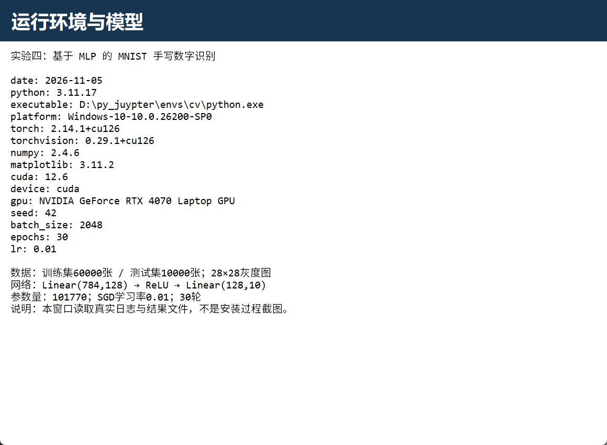
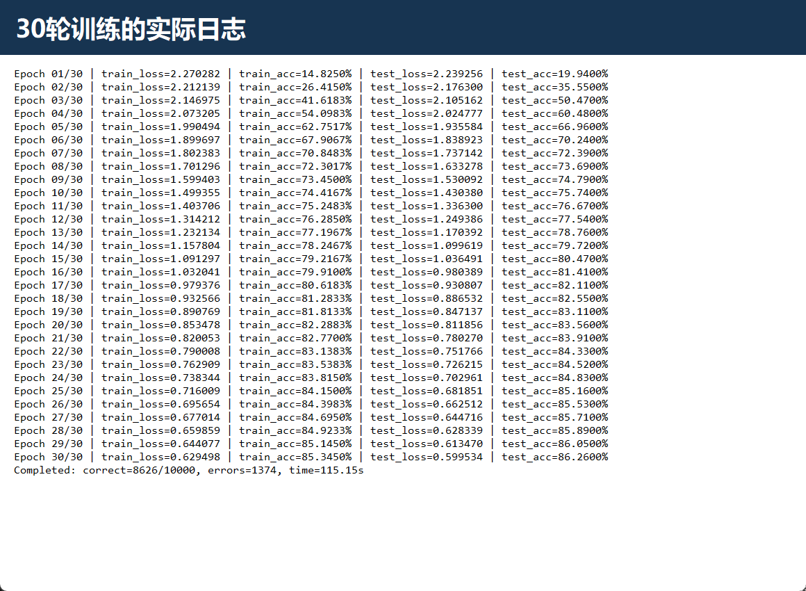
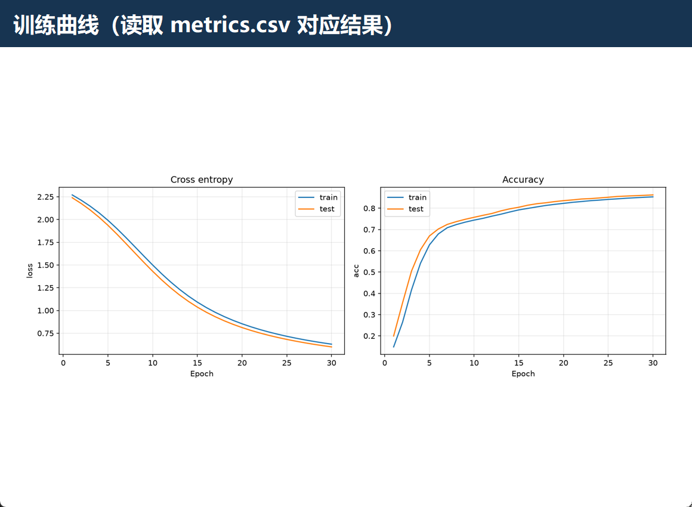
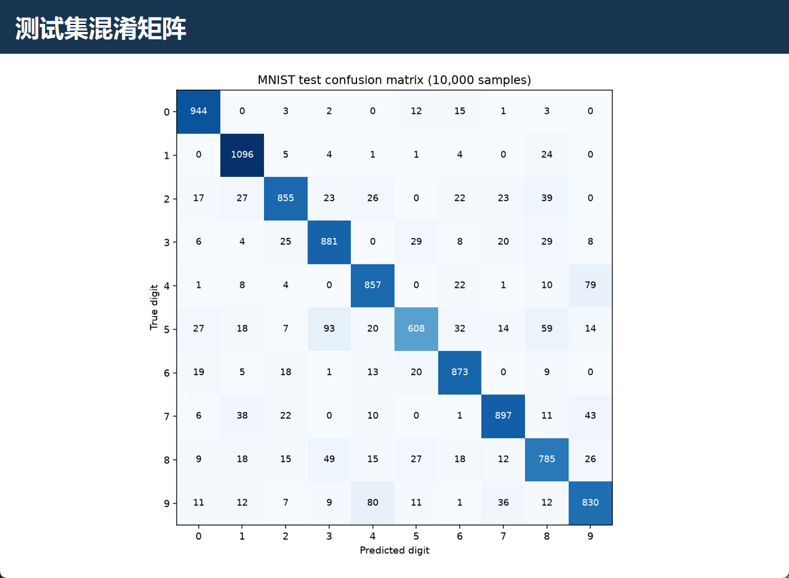
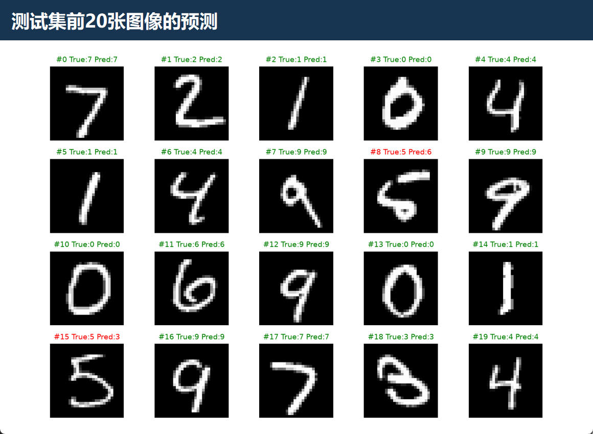
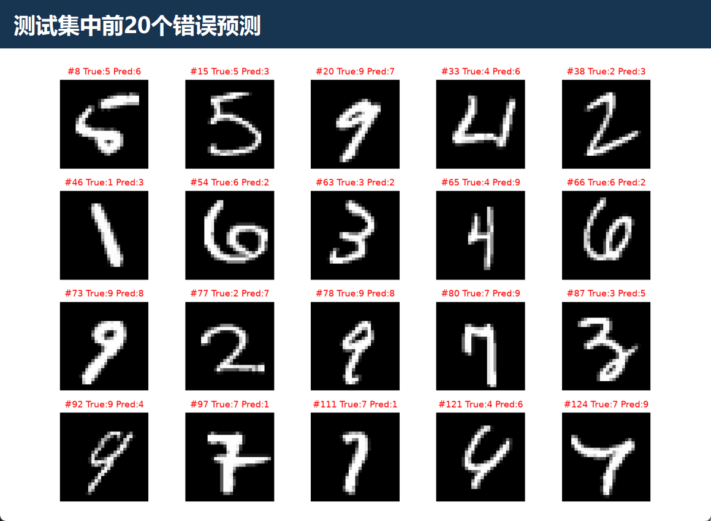

# 实验四：基于多层感知机的 MNIST 手写数字识别

姓名：王泽同    学号：202410315010   班级：人工智能241

## 一、实验目的

在实验一建立的 PyTorch 环境以及实验二、实验三的图像读取、处理基础上，学习使用神经网络进行图像分类。掌握 MNIST 数据加载与张量转换、多层感知机搭建、ReLU 激活、交叉熵损失、SGD 优化、反向传播及测试集评估；通过训练曲线、混淆矩阵和预测样本分析模型的识别能力与局限。

## 二、实验环境

| 项目 | 本次实际环境或参数 |
| --- | --- |
| 实验日期 | 2026年11月5日 |
| 系统 / 终端 | Windows 64位，构建号26200 / PowerShell |
| 虚拟环境 / Python | cv / 3.11.17 |
| 解释器 | `D:\py_juypter\envs\cv\python.exe` |
| PyTorch / torchvision | 2.14.1+cu126 / 0.29.1+cu126 |
| NumPy / Matplotlib | 2.4.6 / 3.11.2 |
| 计算设备 | NVIDIA GeForce RTX 4070 Laptop GPU，device=cuda |
| PyTorch CUDA构建版本 | 12.6，不等同于系统独立 CUDA Toolkit 版本 |
| 数据集 | MNIST：60000张训练图像，10000张测试图像，28×28单通道 |
| 网络结构 | Linear(784,128) → ReLU → Linear(128,10) |
| 优化器 | SGD，学习率0.01，默认无动量、无权重衰减 |
| 批大小 / 轮数 / 随机种子 | 2048 / 30 / 42 |

沿用前序实验的报告结构，但版本号均重新查询，不直接复制旧报告。数据通过 torchvision 的 MNIST 接口下载；未使用自选照片替代数据集，未对训练图像添加增强或额外标准化。



*图1 实际结果展示窗口的环境页。图1—图6均为程序展示真实日志或结果文件后截取的窗口客户区，不是安装过程或实时终端截图。对应原始数据保存在 result 目录。*

## 三、实验过程

### 1. 对照参考代码并准备数据

参考文件《实验四参考代码.pdf》包含 MLP 的数据加载、模型、训练和评估代码。保留其核心算法与超参数，增加中文注释、固定随机种子、日志、模型保存及可视化。参考 PDF 的可用内容为两页代码（页脚编号为1/3、2/3），本报告依据实际可见代码完成。

```python
# ToTensor：uint8灰度图 → [1,28,28]浮点张量，取值[0,1]
train = datasets.MNIST(ROOT/'data', train=True, download=True,
                       transform=transforms.ToTensor())
test = datasets.MNIST(ROOT/'data', train=False, download=True,
                      transform=transforms.ToTensor())
train_loader = torch.utils.data.DataLoader(
    train, batch_size=2048, shuffle=True)
test_loader = torch.utils.data.DataLoader(
    test, batch_size=2048, shuffle=False)
```

训练集原始数据形状为 `(60000,28,28)`。每轮训练30批：29批各2048张，最后一批608张；测试5批：4批各2048张，最后一批1808张。每张图片展开为784维向量，标签为0—9整数，不能把标签当作连续回归值。

相对于参考代码，测试集不打乱是为了固定展示顺序，并不改变覆盖全部样本时的准确率定义。训练集和测试集不混用，测试阶段不更新模型。

### 2. 构建多层感知机

```python
class MLP(nn.Module):
    def __init__(self):
        super().__init__()
        self.l1 = nn.Linear(784, 128)  # 像素向量映射到128维隐藏特征
        self.l2 = nn.Linear(128, 10)   # 输出0—9十类的原始分数

    def forward(self, x):
        return self.l2(F.relu(self.l1(x)))  # 非线性激活位于隐藏层
```

第一层参数为784×128+128=100480；第二层为128×10+10=1290；总参数量为 **101770**。ReLU 定义为 max(0,x)，使两层线性映射之间具有非线性表达能力。最终输出为 `[批大小,10]` 的 logits，而非概率。

交叉熵内部已经包含 log-softmax 运算，不能在送入 `F.cross_entropy` 前再执行 softmax。预测时取 logits 最大值对应的类别即可。

### 3. 训练与反向传播

```python
model = MLP().to(device)
optimizer = torch.optim.SGD(model.parameters(), lr=0.01)
model.train()
for x, y in train_loader:
    x, y = x.flatten(1).to(device), y.to(device)  # 保留实际批次大小
    optimizer.zero_grad()                       # 清除上一批梯度
    logits = model(x)                           # 前向传播
    loss = F.cross_entropy(logits, y)           # 批平均交叉熵
    loss.backward()                            # 计算梯度
    optimizer.step()                           # SGD更新权重
```

共训练30轮，合计900次参数更新。模型与输入张量使用同一 CUDA 设备。`zero_grad()` 防止梯度意外累积；`backward()` 计算梯度但不修改参数，真正更新由 `step()` 完成。

### 4. 测试集评估

```python
model.eval()
test_loss, correct = 0.0, 0
with torch.no_grad():
    for x, y in test_loader:
        logits = model(x.flatten(1).to(device))
        y = y.to(device)
        test_loss += F.cross_entropy(logits, y, reduction='sum').item()
        correct += (logits.argmax(1) == y).sum().item()
test_loss /= len(test_loader.dataset)  # 总损失 / 总样本数
accuracy = correct / len(test_loader.dataset)
```

参考代码将各批平均损失再等权平均；最后一批少于2048张，因此该算法不严格等于全体样本的平均损失。本实现按样本总损失除以10000计算，修正统计口径，不改变训练损失、网络结构和优化方法。

`model.eval()` 切换模块的训练/评估状态；`no_grad()` 则关闭自动求导，两者职责不同。本网络没有 Dropout 或 BatchNorm，所以切换状态不直接改变这两个 Linear 层的计算，但仍保留规范的评估流程。

### 5. 完整运行与日志保存

```powershell
Set-Location 'D:\海事大学\计算机视觉\实验4'
& 'D:\py_juypter\envs\cv\python.exe' -X utf8 .\mlp_mnist.py
# 训练结束后展示结果并自动截取窗口客户区
& 'D:\py_juypter\envs\cv\python.exe' -X utf8 .\show_results.py
```



*图2 30轮训练的实际记录，轮次从1计数；参考代码从0计数，均为30轮。*

| 轮次 | 训练损失 | 训练准确率 | 测试损失 | 测试准确率 |
| --- | ---: | ---: | ---: | ---: |
| 1 | 2.270282 | 14.82% | 2.239256 | 19.94% |
| 5 | 1.990494 | 62.75% | 1.935584 | 66.96% |
| 10 | 1.499355 | 74.42% | 1.430380 | 75.74% |
| 15 | 1.091297 | 79.22% | 1.036491 | 80.47% |
| 20 | 0.853478 | 82.29% | 0.811856 | 83.56% |
| 25 | 0.716009 | 84.15% | 0.681851 | 85.16% |
| 30 | 0.629498 | 85.34% | 0.599534 | 86.26% |

训练损失和训练准确率在各批次参数更新过程中累计；测试指标则使用该轮结束后的固定模型。因此两者并非对同一个模型状态的完全同步评估，不能仅凭测试准确率略高就认定数据泄漏。完整30轮指标保存在 `result/metrics.csv`。

## 四、实验结果与分析

### 1. 收敛过程与最终结果



*图3 实际训练与测试曲线；横轴为轮次，准确率以0—1表示。*

本次第30轮测试损失为 **0.599534**，测试准确率为 **86.26%**；10000张测试图像中正确 **8626** 张，错误 **1374** 张。30轮训练及逐轮评估总耗时约 **115.15秒**，不包含下载数据和生成结果图。该耗时是一次运行记录，不作为设备性能的严格基准。

从首轮到末轮的变化可见，模型通过梯度下降学到了对手写数字有效的分类特征。保持参考配置的目的在于复现基础 MLP 流程，而不是追求最优准确率。大批次和较小学习率使每轮仅有30次更新；可以进一步研究训练轮数、学习率或卷积网络，但本次未开展这些对照实验，不能声称已经验证了优化收益。

### 2. 混淆矩阵与各类召回率



*图4 混淆矩阵：行是真实数字，列是预测数字；对角线表示正确预测数。*

| 数字 | 测试样本数 | 正确数 | 召回率 |
| --- | ---: | ---: | ---: |
| 0 | 980 | 944 | 96.33% |
| 1 | 1135 | 1096 | 96.56% |
| 2 | 1032 | 855 | 82.85% |
| 3 | 1010 | 881 | 87.23% |
| 4 | 982 | 857 | 87.27% |
| 5 | 892 | 608 | 68.16% |
| 6 | 958 | 873 | 91.13% |
| 7 | 1028 | 897 | 87.26% |
| 8 | 974 | 785 | 80.60% |
| 9 | 1009 | 830 | 82.26% |

较多的错误组合为：真实5→预测3：93张；真实9→预测4：80张；真实4→预测9：79张；真实5→预测8：59张；真实8→预测3：49张。这些统计来自全部10000张测试图像，而不只是展示样本。各类别召回率=该类正确数/该类真实样本数，不等于精确率。

### 3. 预测示例与失败样本



*图5 测试集按原顺序取前20张，标题注明样本索引、真实标签和预测标签；绿色表示正确、红色表示错误。*



*图6 按测试集顺序取前20个错误样本，不是人工挑选最典型或最严重的例子。*

手写数字存在倾斜、笔画连接、开口大小与书写习惯差异。MLP 将二维图像展开为向量，不像卷积网络那样显式利用局部连接和空间权重共享，因此容易受位置及笔画形态变化影响。错误图用于观察可能原因，不能单凭个别样本断言所有错误都由同一因素造成。

### 4. 实验边界与参考代码调整

- 保留784→128→10结构、ReLU、交叉熵、SGD、0.01学习率、2048批大小和30轮训练；没有替换成更复杂网络。
- 增加种子42、中文注释、显式打印、模型权重保存和图表；把交互式环境中的裸表达式改为可保存的日志。
- 测试 `shuffle=False`，测试损失采用样本加权平均；训练/测试路径相对于脚本位置，避免工作目录变化导致找不到数据。
- 未使用验证集调参；按固定30轮报告末轮结果，没有按测试集准确率选取最佳检查点。逐轮测试仅用于本次课程观察，不应在反复调整模型时将测试集当作验证集。
- 未进行多随机种子重复实验、其他网络比较或手写照片的域外测试，不能将本次结果推广到所有手写识别场景。

## 五、实验总结

本实验基于给定参考代码完成了 MNIST 数据加载、多层感知机建模、30轮训练、测试评估和结果可视化，使用实验一建立的 GPU 环境完成实际计算，并延续实验二、实验三以真实运行数据和结果图分析问题的报告方式。

通过本实验，理解了张量维度、ReLU、logits与交叉熵的配合、梯度清零和反向传播的作用，以及训练与测试阶段的区别。测试准确率达到86.26%，说明基础 MLP 能识别多数手写数字，但仍有1374张错误。混淆矩阵和失败样本表明，平均准确率不能替代分类别与逐样本分析，后续改进应通过独立验证和对照实验检验。

## 附录：文件说明与完整注释代码

| 文件或目录 | 用途 |
| --- | --- |
| `mlp_mnist.py` | 可直接运行的中文注释训练脚本 |
| `show_results.py` | 读取本次结果、展示并自动截取窗口 |
| `img/` | 报告引用的6张真实屏幕截图 |
| `result/environment.json`、`run_log.txt` | 环境及完整训练日志 |
| `result/metrics.csv`、`summary.json` | 30轮指标及末轮汇总 |
| `result/confusion_matrix.csv`、`predictions.npy` | 混淆矩阵及全部预测，用于核验 |
| `result/mlp_mnist.pt` | 第30轮权重与环境记录 |
| `result/*.png` | 曲线、混淆矩阵与预测示例的原始绘图 |
| `data/MNIST/` | torchvision下载的数据集 |

再次运行会覆盖本目录的同名实验输出；如需比较不同配置，请先备份结果。分享报告时须同时保留 `img` 目录，否则相对路径图片无法显示。

以下为本次运行的完整中文注释代码：

```python
"""实验四：MNIST 手写数字识别。保留参考代码的 MLP 与训练超参数。"""
from pathlib import Path
import csv
import json
import platform
import sys
import time
import random
import numpy as np
import torch
from torch import nn
from torch.nn import functional as F
from torchvision import datasets, transforms
import torchvision
import matplotlib
matplotlib.use('Agg')  # 训练时将图表保存到文件，不阻塞训练进程
from matplotlib import pyplot as plt

ROOT = Path(__file__).resolve().parent
OUT = ROOT / 'result'
OUT.mkdir(exist_ok=True)

class MLP(nn.Module):
    """784维像素输入，经128个ReLU隐藏单元，输出10类原始分数。"""
    def __init__(self):
        super().__init__()
        self.l1 = nn.Linear(784, 128)
        self.l2 = nn.Linear(128, 10)

    def forward(self, x):
        # 交叉熵内部包含log_softmax，此处不能先进行softmax。
        return self.l2(F.relu(self.l1(x)))

def main():
    # 固定随机种子便于复现；不同设备和库版本仍可能存在数值差异。
    random.seed(42)
    np.random.seed(42)
    torch.manual_seed(42)
    if torch.cuda.is_available():
        torch.cuda.manual_seed_all(42)
    torch.set_num_threads(4)
    device = torch.device('cuda' if torch.cuda.is_available() else 'cpu')
    batch_size, epochs = 2048, 30
    env = dict(date='2026-11-05', python=sys.version, executable=sys.executable,
               platform=platform.platform(), torch=torch.__version__,
               torchvision=torchvision.__version__, numpy=np.__version__,
               matplotlib=matplotlib.__version__, cuda=torch.version.cuda,
               device=str(device), gpu=torch.cuda.get_device_name(0) if device.type=='cuda' else None,
               seed=42, batch_size=batch_size, epochs=epochs, lr=0.01)
    (OUT/'environment.json').write_text(json.dumps(env,ensure_ascii=False,indent=2),encoding='utf-8')
    log = []
    def report(s):
        print(s, flush=True)
        log.append(s)
        (OUT/'run_log.txt').write_text('\n'.join(log), encoding='utf-8')
    report(json.dumps(env, ensure_ascii=False, indent=2))
    # ToTensor将28×28灰度图转换为[1,28,28]浮点张量，像素缩放到[0,1]。
    train = datasets.MNIST(ROOT/'data', train=True, download=True, transform=transforms.ToTensor())
    test = datasets.MNIST(ROOT/'data', train=False, download=True, transform=transforms.ToTensor())
    train_loader = torch.utils.data.DataLoader(train, batch_size=batch_size, shuffle=True)
    # 测试不打乱，便于稳定展示样本；全测试集准确率与排列无关。
    test_loader = torch.utils.data.DataLoader(test, batch_size=batch_size, shuffle=False)
    model = MLP().to(device)
    optimizer = torch.optim.SGD(model.parameters(), lr=0.01)
    report(f'Train={len(train)}, test={len(test)}, raw shape={tuple(train.data.shape)}')
    report(f'{model}\nParameters={sum(p.numel() for p in model.parameters())}')
    history = []
    start = time.perf_counter()
    for epoch in range(1, epochs+1):
        model.train()
        total_loss, correct = 0.0, 0
        for x,y in train_loader:
            # 按当前批次大小展开；最后一批可能不足2048，不能写死批次维度。
            x, y = x.flatten(1).to(device), y.to(device)
            optimizer.zero_grad()  # 清除上一批梯度，避免意外累加
            logits = model(x)
            loss = F.cross_entropy(logits,y)
            loss.backward()  # 反向传播，计算所有可训练参数的梯度
            optimizer.step()  # 按SGD规则更新权重与偏置
            total_loss += loss.item()*y.size(0)
            correct += (logits.argmax(1)==y).sum().item()
        train_loss, train_acc = total_loss/len(train), correct/len(train)
        model.eval()
        test_loss, correct = 0.0, 0
        predictions = []
        with torch.no_grad():  # 测试不计算梯度、不更新参数
            for x,y in test_loader:
                logits = model(x.flatten(1).to(device))
                y = y.to(device)
                # 按样本求和后除以总样本数，避免末批大小不同造成均值偏差。
                test_loss += F.cross_entropy(logits,y,reduction='sum').item()
                pred = logits.argmax(1)
                correct += (pred==y).sum().item()
                predictions.append(pred.cpu())
        row = dict(epoch=epoch, train_loss=train_loss, train_acc=train_acc,
                   test_loss=test_loss/len(test), test_acc=correct/len(test))
        history.append(row)
        report(f'Epoch {epoch:02d}/30 | train_loss={train_loss:.6f} | train_acc={train_acc:.4%} | test_loss={row["test_loss"]:.6f} | test_acc={row["test_acc"]:.4%}')
    elapsed = time.perf_counter()-start
    pred = torch.cat(predictions).numpy()
    truth = test.targets.numpy()
    cm = np.zeros((10,10),dtype=np.int64)
    np.add.at(cm,(truth,pred),1)
    np.save(OUT/'predictions.npy',pred)
    np.savetxt(OUT/'confusion_matrix.csv',cm,fmt='%d',delimiter=',')
    with (OUT/'metrics.csv').open('w',newline='',encoding='utf-8') as f:
        writer=csv.DictWriter(f,fieldnames=list(history[0])); writer.writeheader(); writer.writerows(history)
    torch.save({'state_dict':model.cpu().state_dict(),'environment':env},OUT/'mlp_mnist.pt')
    summary=dict(final=history[-1], correct=int((pred==truth).sum()), errors=int((pred!=truth).sum()),
                 training_seconds=elapsed, parameters=sum(p.numel() for p in model.parameters()),
                 per_class_recall=(cm.diagonal()/cm.sum(1)).tolist())
    (OUT/'summary.json').write_text(json.dumps(summary,indent=2),encoding='utf-8')
    report(f'Completed: correct={summary["correct"]}/10000, errors={summary["errors"]}, time={elapsed:.2f}s')
    # 保存真实运行产生的曲线、混淆矩阵和预测示例；它们不是屏幕截图。
    fig,axes=plt.subplots(1,2,figsize=(12,4))
    for key,ax in [('loss',axes[0]),('acc',axes[1])]:
        for split in ['train','test']:
            ax.plot([r['epoch'] for r in history],[r[split+'_'+key] for r in history],label=split)
        ax.set(xlabel='Epoch',ylabel=key,title='Cross entropy' if key=='loss' else 'Accuracy'); ax.legend(); ax.grid(alpha=.3)
    fig.tight_layout(); fig.savefig(OUT/'curves.png',dpi=150); plt.close(fig)
    fig,ax=plt.subplots(figsize=(8,7)); ax.imshow(cm,cmap='Blues')
    for i in range(10):
        for j in range(10): ax.text(j,i,str(cm[i,j]),ha='center',va='center',color='white' if cm[i,j]>600 else 'black',fontsize=9)
    ax.set(xticks=range(10),yticks=range(10),xlabel='Predicted digit',ylabel='True digit',title='MNIST test confusion matrix (10,000 samples)')
    fig.tight_layout(); fig.savefig(OUT/'confusion.png',dpi=140); plt.close(fig)
    for name,indices in [('samples',np.arange(20)),('errors',np.flatnonzero(pred!=truth)[:20])]:
        fig,axes=plt.subplots(4,5,figsize=(10,7))
        for ax,i in zip(axes.flat,indices):
            ax.imshow(test.data[i],cmap='gray'); ax.set_title(f'#{i} True:{truth[i]} Pred:{pred[i]}',color='green' if pred[i]==truth[i] else 'red',fontsize=10); ax.axis('off')
        fig.tight_layout(); fig.savefig(OUT/(name+'.png'),dpi=140); plt.close(fig)

if __name__=='__main__':
    main()  # Windows下保持主入口保护，以便未来使用多进程DataLoader。

```
