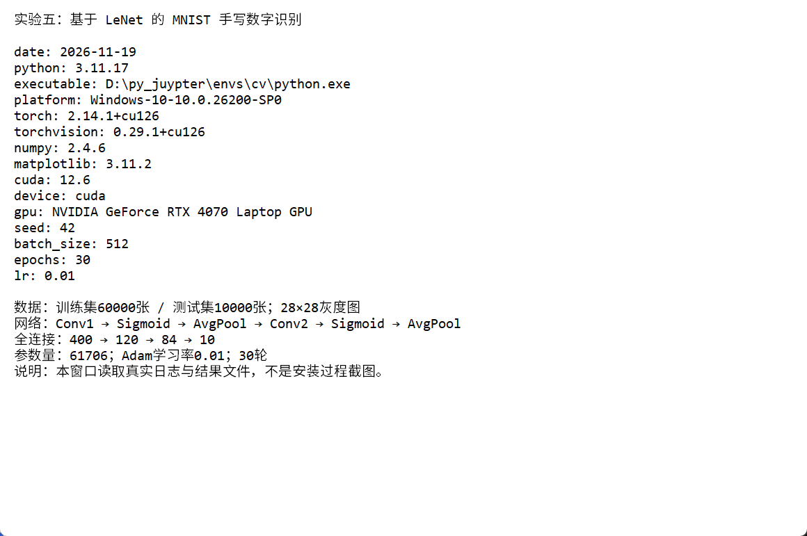
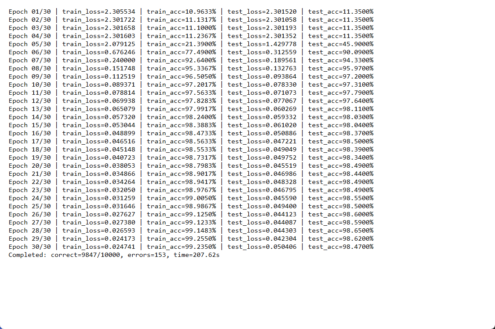
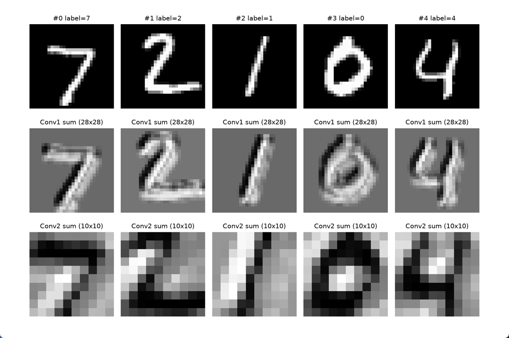
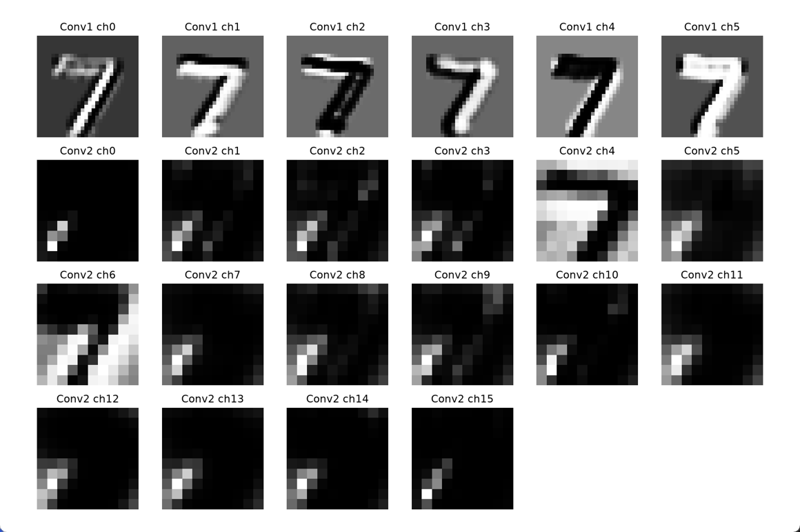
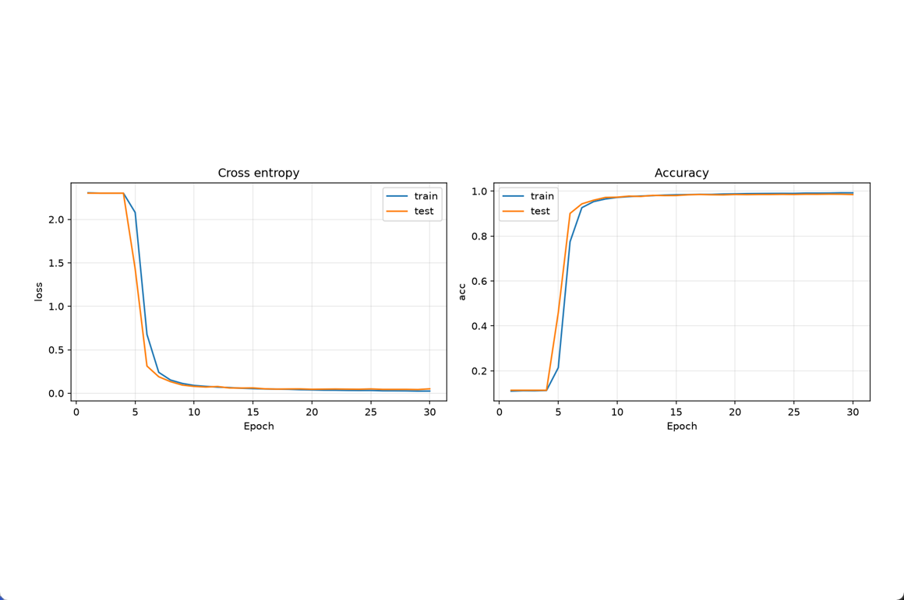
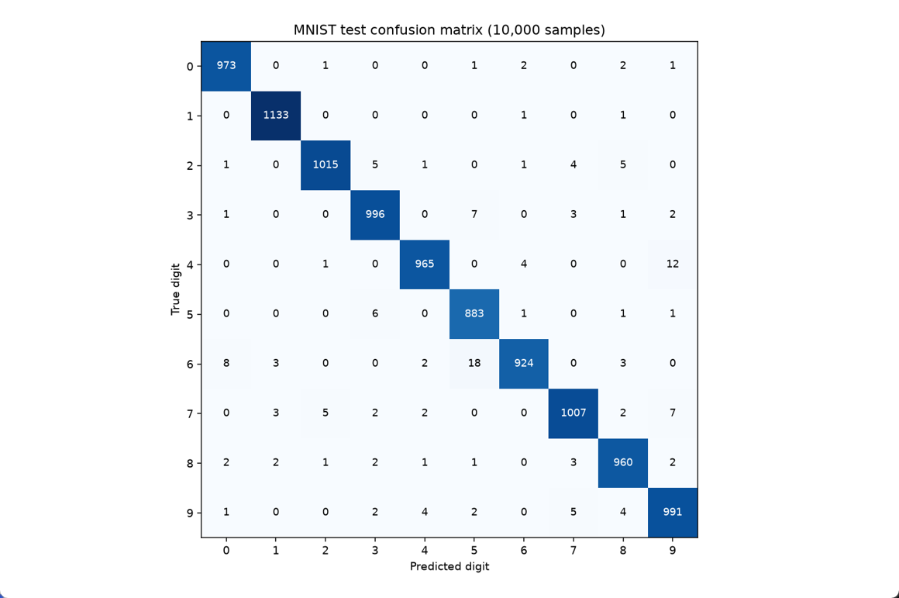
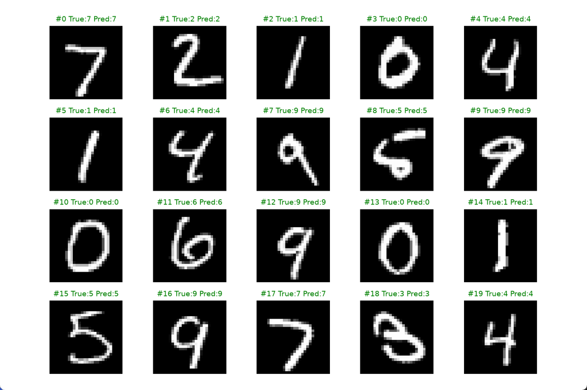
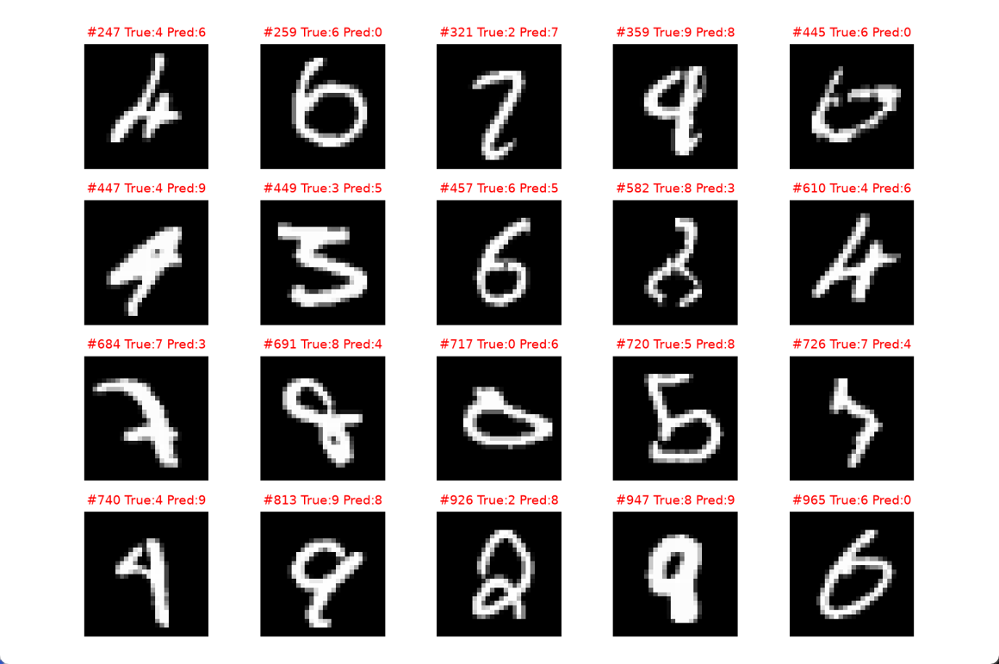

# 实验五：基于 LeNet 卷积神经网络的手写数字识别

姓名：王泽同    学号：202410315010   班级：人工智能241

## 一、实验目的

在实验一的 PyTorch 环境和实验四的 MNIST 多层感知机分类基础上，补全给定 LeNet 风格卷积网络，掌握卷积层、Sigmoid 激活、平均池化和全连接分类的组织方式；理解特征张量尺寸变化、训练与测试流程，观察不同卷积通道的响应，结合真实训练曲线和错误样本分析识别效果。

## 二、实验环境

| 项目 | 本次实际环境或设置 |
| --- | --- |
| 实验日期 | 2026年11月19日 |
| 操作系统 / 终端 | Windows 64位，构建号26200 / PowerShell |
| Python / 虚拟环境 | 3.11.17 / cv |
| 解释器 | `D:\py_juypter\envs\cv\python.exe` |
| PyTorch / torchvision | 2.14.1+cu126 / 0.29.1+cu126 |
| NumPy / Matplotlib | 2.4.6 / 3.11.2 |
| GPU | NVIDIA GeForce RTX 4070 Laptop GPU |
| PyTorch CUDA构建版本 | 12.6 |
| 数据集 | MNIST，训练60000张、测试10000张，28×28灰度图 |
| 批大小 / 训练轮数 | 512 / 30 |
| 优化器 / 学习率 | Adam / 0.01（参考代码1e-2） |
| 随机种子 | 42 |
| 激活 / 下采样 | Sigmoid / 2×2平均池化，步长2 |

复用实验四已下载的 MNIST 缓存，不修改实验四代码或结果。输入由 `ToTensor()` 转为 `[0,1]` 浮点张量，本次不增加数据增强或其他归一化。未将参考PDF页眉的历史日期作为本次实验日期。



*图1 实际结果展示窗口。图1—图8均为读取本次日志及结果文件后截取的窗口客户区，并裁去顶部蓝色标题栏；不是安装截图，也不是把绘图文件直接冒充屏幕截图。原始绘图另存于 result 目录。*

## 三、实验过程

### 1. 检查参考代码并补全网络

工作目录内提供了《实验五参考代码.pdf》，未提供独立的半成品 `.py` 文件。因此依据PDF三页中已有的训练框架和网络注释，整理成 `lenet.py`，保留参考超参数并完成空缺代码。该网络是适配28×28输入的 LeNet 风格实现，不声称逐项复刻原始 LeNet-5 的全部细节。

```python
class Net(nn.Module):
    """按参考代码补全的LeNet风格网络；输入[B,1,28,28]。"""
    def __init__(self):
        super().__init__()
        self.conv1 = nn.Conv2d(1, 6, kernel_size=5, padding=2)
        self.conv2 = nn.Conv2d(6, 16, kernel_size=5)
        self.fc1 = nn.Linear(5*5*16, 120)
        self.fc2 = nn.Linear(120, 84)
        self.clf = nn.Linear(84, 10)

    def features(self, x):
        # 第一层保持28×28，再经2×2平均池化降为14×14。
        feature1 = torch.sigmoid(self.conv1(x))
        pool1 = F.avg_pool2d(feature1, kernel_size=2, stride=2)
        # 第二层无padding，14×14变10×10，再池化为5×5。
        feature2 = torch.sigmoid(self.conv2(pool1))
        pool2 = F.avg_pool2d(feature2, kernel_size=2, stride=2)
        return feature1, pool1, feature2, pool2

    def forward(self, x):
        _, _, _, x = self.features(x)
        x = torch.flatten(x, start_dim=1)  # 保留批维度，16×5×5=400
        x = torch.sigmoid(self.fc1(x))
        x = torch.sigmoid(self.fc2(x))
        return self.clf(x)  # 输出logits，交叉熵内部处理log-softmax

```

参考第三页的 `feature2` 计算被注释，却在后面直接使用，会触发未定义变量错误。本次将两层激活与池化统一放入 `features()`：第二层卷积必须接收第一层池化后的6通道特征，不能直接接收原始单通道图像。训练前已用两张零输入核对各层形状和最终10维输出。

### 2. 数据加载与尺寸变化

```python
train_loader = torch.utils.data.DataLoader(train, batch_size=512, shuffle=True)
test_loader = torch.utils.data.DataLoader(test, batch_size=512, shuffle=False)
# CNN输入保持四维，不像实验四那样在进入网络前展平。
x, y = x.to(device), y.to(device)
```

每轮训练118批，最后一批96张；测试20批，最后一批272张。测试不打乱用于固定样本顺序，全部样本都参与评估。卷积输出尺寸公式为 `floor((输入尺寸+2×padding−kernel_size)/stride)+1`，本实验卷积步长为1。

| 层 / 操作 | 单张图像的输出形状 | 可训练参数量 |
| --- | --- | ---: |
| 输入 | 1×28×28 | 0 |
| Conv1：1→6，5×5，padding=2 + Sigmoid | 6×28×28 | 156 |
| AvgPool：2×2，stride=2 | 6×14×14 | 0 |
| Conv2：6→16，5×5，padding=0 + Sigmoid | 16×10×10 | 2416 |
| AvgPool：2×2，stride=2 | 16×5×5 | 0 |
| Flatten，从第1维开始 | 400 | 0 |
| Linear(400,120) + Sigmoid | 120 | 48120 |
| Linear(120,84) + Sigmoid | 84 | 10164 |
| Linear(84,10) | 10 | 850 |
| 合计 | — | **61706** |

平均池化取局部2×2窗口的均值，没有可训练参数。Sigmoid 将值映射到(0,1)，其导数最大为1/4，较大正负输入下容易饱和；本次按题目要求保留 Sigmoid，未擅自替换为 ReLU 或最大池化。

### 3. 训练与测试

```python
model = Net().to(device)
optimizer = torch.optim.Adam(model.parameters(), lr=0.01)
model.train()
for x, y in train_loader:
    x, y = x.to(device), y.to(device)
    optimizer.zero_grad()          # 清除上一批梯度
    out = model(x)                 # 原始分类分数logits
    loss = F.cross_entropy(out, y) # 内部包含log-softmax
    loss.backward()                # 反向传播
    optimizer.step()               # Adam更新参数
```

分类层后不增加 Sigmoid 或 softmax。交叉熵接收logits和整数类别标签，预测取 `argmax(dim=1)`。每轮结束后使用 `model.eval()` 和 `torch.no_grad()` 在完整测试集上评估，不更新参数；每轮开始重新 `model.train()`。本网络没有 Dropout/BatchNorm，但显式区分状态便于后续扩展。

测试损失采用 `reduction='sum'` 累加后除以10000，与参考“各批平均损失再等权平均”不同。由于末批只有272张，样本加权平均才是全测试集的平均交叉熵；此调整仅改变统计方式，不改变训练过程。

```powershell
Set-Location 'D:\海事大学\计算机视觉\实验5'
& 'D:\py_juypter\envs\cv\python.exe' -X utf8 .\lenet.py
& 'D:\py_juypter\envs\cv\python.exe' -X utf8 .\show_results.py
```



*图2 真实30轮日志。报告从1计数，参考代码从0计数，均为30轮。*

| 轮次 | 训练损失 | 训练准确率 | 测试损失 | 测试准确率 |
| --- | ---: | ---: | ---: | ---: |
| 1 | 2.305534 | 10.96% | 2.301520 | 11.35% |
| 2 | 2.301722 | 11.13% | 2.301058 | 11.35% |
| 5 | 2.079125 | 21.39% | 1.429778 | 45.90% |
| 10 | 0.089371 | 97.20% | 0.078330 | 97.31% |
| 15 | 0.053044 | 98.39% | 0.061020 | 98.04% |
| 20 | 0.038053 | 98.80% | 0.045519 | 98.49% |
| 25 | 0.031646 | 98.99% | 0.049400 | 98.50% |
| 30 | 0.024741 | 99.23% | 0.050406 | 98.47% |

训练指标在参数不断更新的过程中累计，测试指标使用该轮结束后的固定模型，两者不完全是同一模型状态的同步测量。完整数据保存为 `result/metrics.csv`。

### 4. 卷积特征图可视化

固定选取测试集索引0—4，而不使用训练/测试循环残留的最后一个 `x`。其标签依次为7、2、1、0、4。

```python
model.eval()
x = torch.stack([test[i][0] for i in range(5)])  # 此时模型与输入都在CPU
with torch.no_grad():
    feature1, pool1, feature2, pool2 = model.features(x)
# 每张图像沿通道求和，得到二维灰度展示图
feature_map1 = feature1[i].sum(0).numpy()  # 6×28×28 → 28×28
feature_map2 = feature2[i].sum(0).numpy()  # 16×10×10 → 10×10
```



*图7 从上到下为原始图像、第一层卷积后Sigmoid激活的通道和、第二层卷积后Sigmoid激活的通道和。第二层卷积的输入经过第一次池化；图中两行激活分别在各自池化前取出。*



*图8 测试样本0（数字7）的逐通道响应：首行6个Conv1通道，其余为16个Conv2通道。*

保存的 `features.npz` 同时包含原图、两层激活和两层池化结果，便于检查尺寸和数值。通道求和是显示方式，不是网络新增的处理层；逐通道图可补充观察求和时被掩盖的差异。绘图采用每张子图自动缩放灰度，亮暗不能直接用于比较不同通道的绝对响应强弱，也不能将激活图等同于有严格解释保证的注意力图。

实际观察中，第一层通道和仍保留较清楚的数字轮廓，背景由原图的黑色变为灰色；第二层通道和只有10×10，呈现更粗的块状响应，不能要求它与原图同样清晰。样本0的第一层不同通道分别表现出亮笔画、暗笔画及边界响应；第二层部分通道较稀疏，另一些响应较强。这些现象表明各通道学习到的响应不同，但不据此给每个通道强行赋予固定语义。

## 四、实验结果与分析

### 1. 训练过程与最终结果



*图3 训练/测试交叉熵和准确率曲线，准确率轴采用0—1数值。*

最终第30轮测试损失为 **0.050406**，准确率为 **98.47%**，10000张中正确 **9847** 张、错误 **153** 张。训练及逐轮评估耗时约 **207.62秒**，不含结果绘图和截图。网络共61706个可训练参数，30轮总计3540次参数更新。

首轮测试准确率为11.35%，测试损失为2.301520；应结合后续各轮曲线判断学习情况，不能用首轮低准确率单独认定模型失败。曲线用于观察变化，不假设每轮准确率一定上升。单次实验不能证明已取得最优超参数或普遍泛化性能。

第28轮测试准确率为98.65%，第30轮回落到98.47%，同时测试损失由第29轮0.042304升至0.050406。这说明后期存在波动，不能把训练损失下降等同于测试性能必然提升；单次末轮波动不足以断言严重过拟合。本报告仍使用预先规定的第30轮结果。

本次前4轮测试准确率均为11.35%，损失约2.30；第5轮提升到45.90%，第6轮达到90.09%，此后继续提升并伴有波动。初期损失接近十分类均匀输出的 ln(10)≈2.3026，说明初始区分能力弱；11.35%也恰好等于测试集中数字1的比例，但未保存各早期轮次的预测，不能仅凭这一比例断言当时所有样本均被判成1。Sigmoid饱和和优化配置可能影响初期学习，尚无梯度统计或对照实验支持具体因果判断。

### 2. 混淆矩阵和错误样本



*图4 行为真实标签，列为预测标签；对角线为正确分类数。*

| 数字 | 测试样本数 | 正确数 | 召回率 |
| --- | ---: | ---: | ---: |
| 0 | 980 | 973 | 99.29% |
| 1 | 1135 | 1133 | 99.82% |
| 2 | 1032 | 1015 | 98.35% |
| 3 | 1010 | 996 | 98.61% |
| 4 | 982 | 965 | 98.27% |
| 5 | 892 | 883 | 98.99% |
| 6 | 958 | 924 | 96.45% |
| 7 | 1028 | 1007 | 97.96% |
| 8 | 974 | 960 | 98.56% |
| 9 | 1009 | 991 | 98.22% |

主要混淆组合为：真实6→预测5：18张；真实4→预测9：12张；真实6→预测0：8张；真实7→预测9：7张；真实3→预测5：7张。召回率按该类正确数除以该类真实样本数计算，不等同于精确率。



*图5 测试集前20张预测，标题给出样本索引、真实类别和预测类别。*



*图6 按数据顺序取前20个错误样本；不是手工挑选或外部照片。*

错误分析需要结合具体笔画形态和真实标签。手写数字的倾斜、笔画连接、开口和粗细差异可能导致混淆，但仅凭可视化不能确认每个错误的因果机制。本次未单独测试旋转、噪声或真实拍照场景的鲁棒性。

### 3. 与实验四的联系与比较

| 项目 | 实验四：MLP | 实验五：本网络 |
| --- | --- | --- |
| 输入处理 | 提前展开为784维向量 | 保留1×28×28空间结构 |
| 特征提取 | 全连接 + ReLU | 两层卷积 + Sigmoid + 平均池化 |
| 参数量 | 101770 | 61706 |
| 优化器 / 批大小 | SGD / 2048 | Adam / 512 |
| 训练轮数 / 更新次数 | 30 / 900 | 30 / 3540 |
| 最终测试准确率 | 86.26% | 98.47% |

相较已有实验四结果，本次准确率变化为 **+12.21个百分点**。卷积通过局部连接与权重共享利用图像结构，参数量也少于前次MLP。但两次的优化器、激活函数、批大小和更新次数同时不同，这不是仅改变网络结构的严格消融实验，不能将全部差异归因于卷积。

### 4. 记录范围与复现说明

1. 保留参考的网络层数、Sigmoid、平均池化、Adam、学习率、批大小和轮数，补齐网络与特征图计算。
2. 增加种子42、训练/测试状态切换、按样本平均损失、固定顺序测试、权重保存与可视化；使用 `torch.sigmoid` 替代参考的 `F.sigmoid` 写法。
3. 未以测试集选取最佳轮次，报告固定30轮的末轮模型；未进行多随机种子重复实验或验证集调参。后续调参应另划验证集，避免反复利用测试集选择模型。
4. 缓存路径不存在时回退到本实验 `data` 目录下载；再次运行覆盖本实验的同名输出，需要比较时应先备份。

保存权重后，已在CPU重新加载模型，对全部10000张测试图像再次推理，预测类别与训练运行保存的结果逐项一致；并核对30轮指标、混淆矩阵总数、所有特征尺寸和8个截图链接。验证记录保存在 `result/verification.txt`。

## 五、实验总结

本实验补全并运行了参考 LeNet 风格卷积神经网络，实现MNIST加载、30轮训练、测试评估及两层卷积特征可视化。通过尺寸断言明确了28→14→10→5的空间变化和400维展平输入，理解了卷积、平均池化、Sigmoid与全连接分类层的作用。

本次最终测试准确率为98.47%。结合训练日志、混淆矩阵与错误样本，既验证了代码可执行性，也保留了模型实际失误。特征图用于观察不同通道响应，不将灰度图的视觉效果当作模型解释或因果证明。

## 附录：交付文件

| 文件 | 内容 |
| --- | --- |
| `lenet.py` | 补全的训练、评估和特征可视化代码，含中文注释 |
| `show_results.py` | 真实结果展示和8张窗口截图生成 |
| `img/` | 报告引用的截图，分享时需与报告一起保留 |
| `result/metrics.csv`、`summary.json` | 每轮指标与末轮汇总 |
| `result/environment.json`、`run_log.txt` | 实际环境与日志 |
| `result/lenet_mnist.pt` | 第30轮权重与环境记录 |
| `result/predictions.npy`、`confusion_matrix.csv` | 全测试集预测与混淆矩阵 |
| `result/features.npz` | 前5张测试图像及各阶段特征张量 |
| `result/*.png` | 曲线、分类结果与特征图原始绘图 |

完整中文注释代码见同目录 `lenet.py`，报告不再重复全文。
